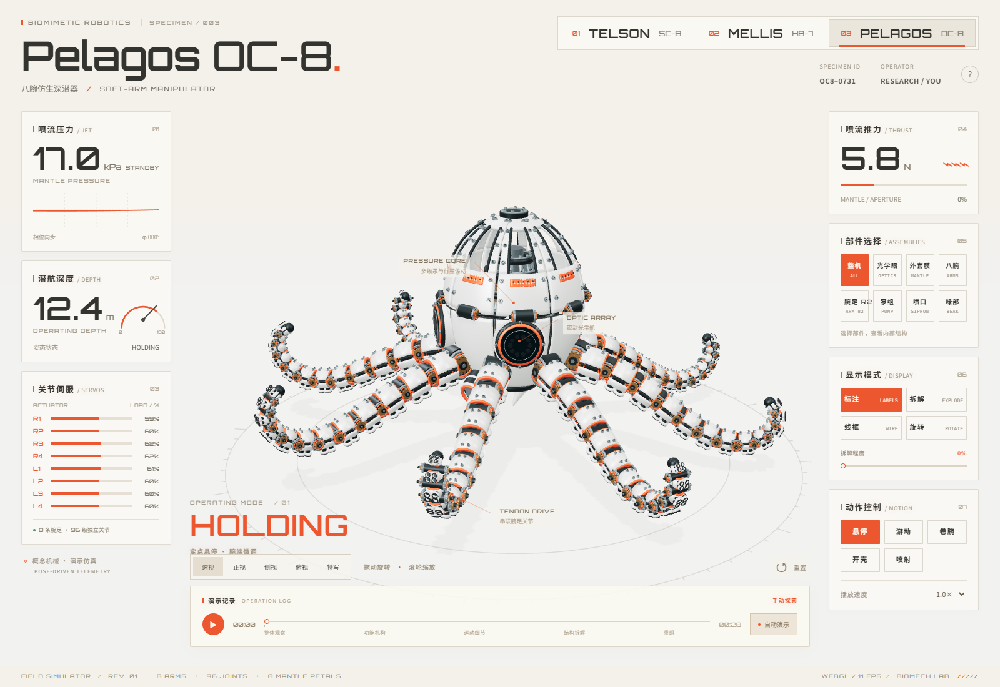
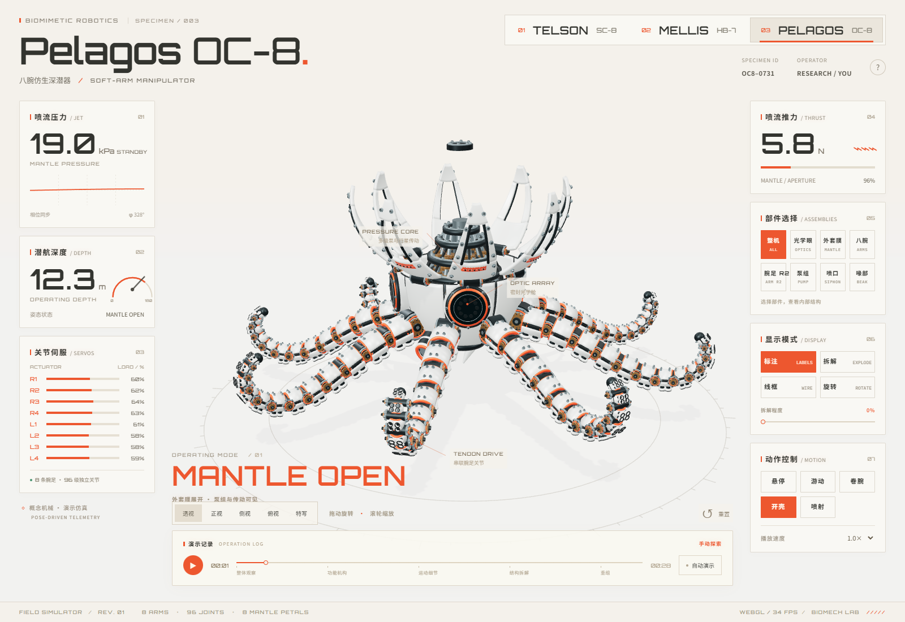
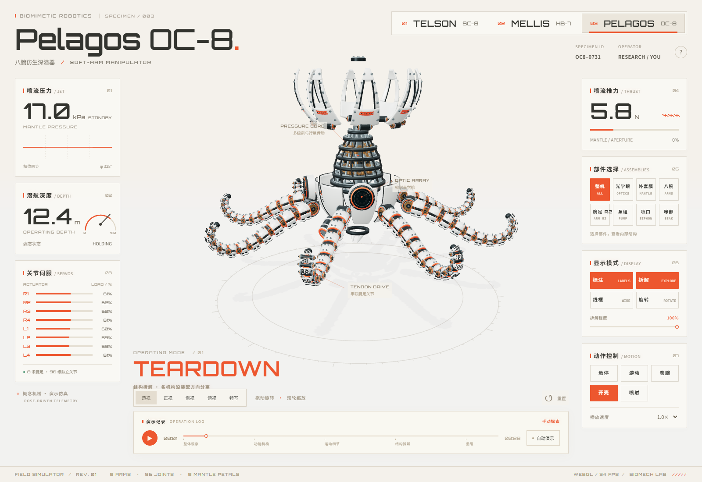
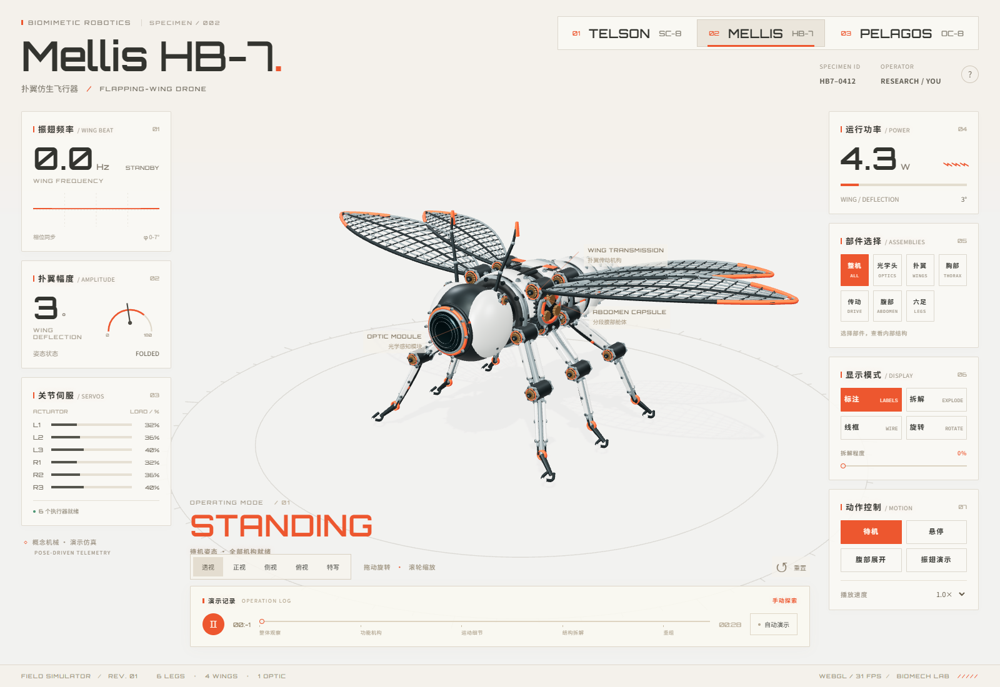
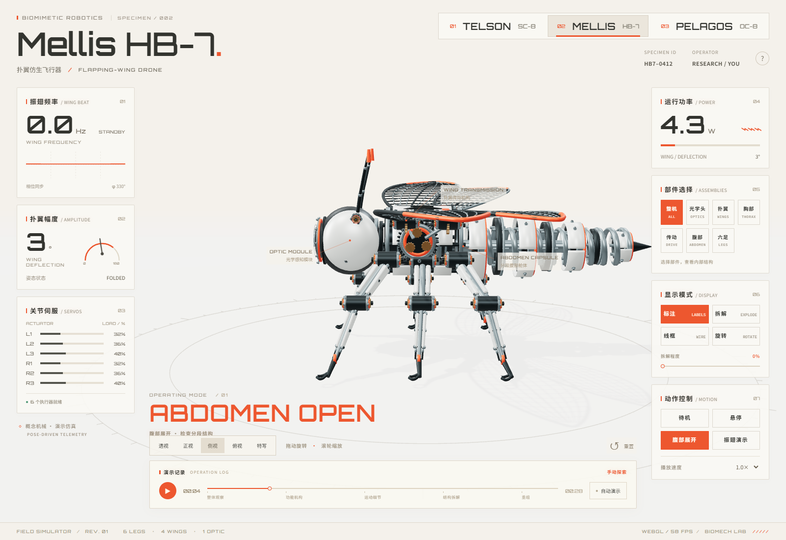
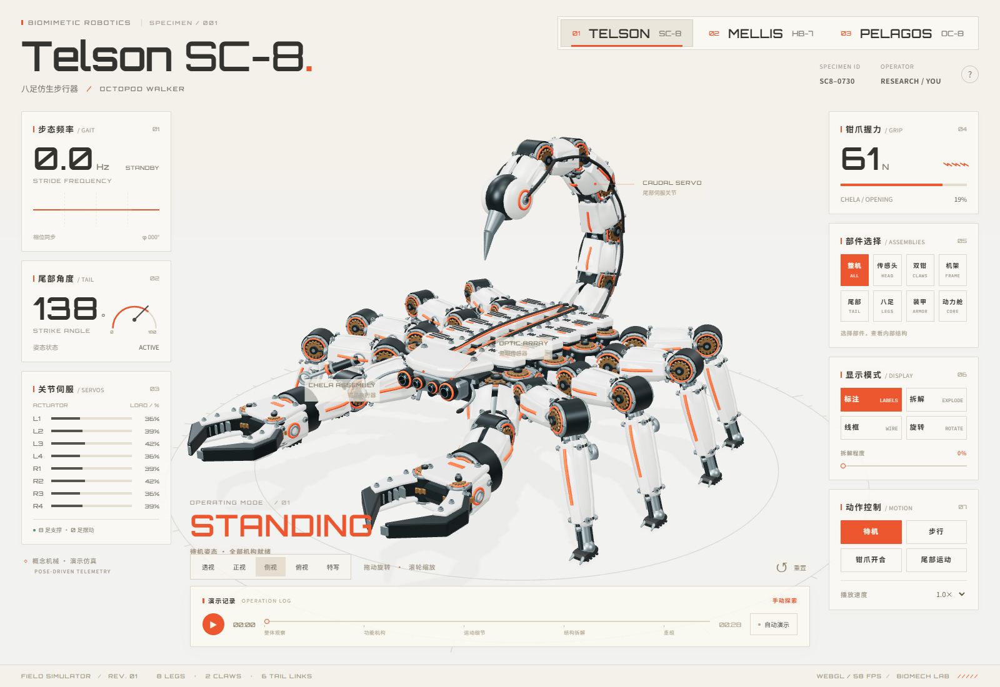
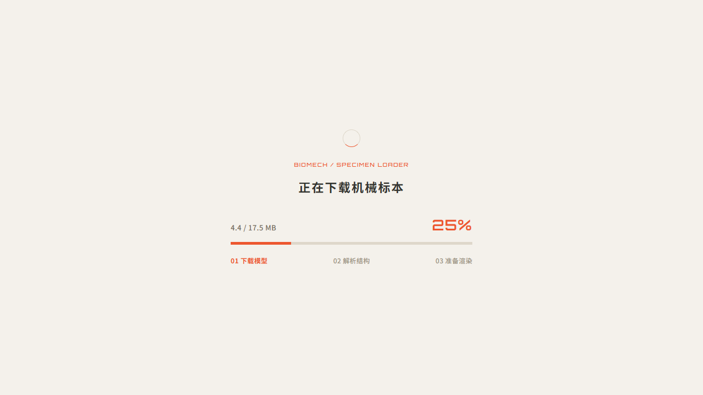

# BIOMECH / 仿生机械实验室

**PELAGOS OC-8 · MELLIS HB-7 · TELSON SC-8**

交互式三维标本 · Blender 可编辑结构 · 在线与离线双入口

> 从外壳看到内部，从静态标本看到机构运动。

BIOMECH 将三种机械生物参考动图转化为可以旋转、拆解、选取部件和操作的三维实验室。REV 03 新增机械章鱼，并重建蜜蜂、扩充蝎子的装甲结构。网页与仪表使用同一套姿态数据；模型保留完整几何，通过批量绘制减少浏览器的提交开销。



## 三个标本，一套实验室

| 标本 | 结构细节 | 可操作机构 |
| --- | --- | --- |
| **OC-8 / Pelagos** | 8 条渐细腕足、96 个串联关节、吸盘阀体、密封圈、8 片外套膜、光学眼、多级泵组、喷口与喙部 | 悬停、游动、卷腕、开壳、喷射；独立观察 R2 腕足 |
| **HB-7 / Mellis** | 4 片透明翼膜与翼脉、翼根轴承、胸腔空间桁架、减速齿轮、7 节腹环、回位弹簧、6 足关节、光学头 | 悬停、振翅、腹部伸展；翼根传动与足部收拢同步 |
| **SC-8 / Telson** | 8 足独立关节、液压杆、双钳传动、中空分体陶瓷装甲、6 段尾部、动力舱和检修接口 | IK 步行与足端接地、双钳错峰开合、尾部错相摆动 |

### OC-8 / 打开外套膜

外壳绕真实铰链向外展开，露出泵组、轴承、齿轮和内部支撑。腕足沿关节链连续卷曲，每段长度保持不变。



<details>
<summary>展开查看章鱼装配分解</summary>



</details>

### HB-7 / 微型飞行机构



腹部展开会拉开环节并伸长回位弹簧，侧视可以观察导向轴、壳片与环形支撑之间的关系。



### SC-8 / 分段装甲与精密关节



<details>
<summary>展开查看近景、拆解和步行</summary>


</details>

## 体验与画面

- **完整交互**：拖动旋转、缩放、点击部件、部件隔离、装配分解、线框、标注、五个相机预设、旋转台和 28 秒导览。
- **姿态驱动仪表**：压力、推力、翼角、钳爪开度与关节状态取自当前动画姿态。模式切换平滑过渡，支持暂停、变速与时间轴定位。
- **保留高精度**：没有加入减面或低精度 LOD；透明翼膜、金属、陶瓷、抗锯齿与 2048² 阴影保留。批量绘制与原始可拾取场景图并存。
- **清晰的中文控制台**：Noto Sans SC 搭配 Orbitron，三枚模型标签位于可视区右上角；手机端控制区纵向排布，长数字与标签不会挤出卡片。
- **统一 Loading**：HTML 首屏直接显示静态 Loading，下载时展示真实字节进度，解析与准备渲染使用阶段提示，失败可重试。

<details>
<summary>查看手机端控制台</summary>


</details>

### 当前模型规模

| 标本 | Blender 可编辑对象¹ | 导出网格 | GLB 大小 | 整机绘制调用² |
| --- | ---: | ---: | ---: | ---: |
| OC-8 | 9,644 | 725 | 36.2 MiB | 18 |
| HB-7 | 2,203 | 208 | 8.9 MiB | 22 |
| SC-8 | 6,206 | 737 | 17.5 MiB | 26 |

¹ 包含网格、曲线和关节空对象，不等于独立的工程零件数。导出仅按刚性父节点和材质合批，保留几何与法线；可编辑源文件不会被合批覆盖。

² Windows / Chrome Headless / WebGL 2 / 1600×1100 / DPR 1，支持 `WEBGL_multi_draw`。部件隔离、线框与不支持此扩展的浏览器使用原始网格，调用数会增加。这是绘制统计，不是所有设备的帧率保证。[本版统计](docs/precision-revision.json) · [历史优化实验](docs/performance.md)

## 快速开始

需要 Node.js 20.19+ 或 22.12+。

```powershell
npm install
npm run dev
```

访问 <http://127.0.0.1:5173/>。右上角 **TELSON / MELLIS / PELAGOS** 切换标本。

## 构建、部署与双击打开

```powershell
npm run build
```

生成的 `dist/index.html` 内嵌应用代码和样式，入口约 0.7 MiB。模型与字体保留为外部文件：

```text
dist/
├─ index.html               双击入口 / 网站入口
├─ assets/                  字体和构建资源
└─ models/
   ├─ manifest.json
   ├─ telson-sc8.glb
   ├─ mellis-hb7.glb
   ├─ pelagos-oc8.glb
   └─ *.glb.js              file:// 离线数据文件
```

**部署时上传整个 `dist` 的内容；本地使用时保留完整文件夹，再双击 `index.html`。** 无需安装本地服务器，也不需要修改浏览器安全设置。在线请求按需加载 GLB，离线只读取对应模型的 `.glb.js`。

Loading 在 HTML 下载初期就可见；模型加载完成后才显示主界面。下载百分比来自真实接收字节，解析和 GPU 准备阶段不伪造百分比。



## 操作方式

| 操作 | 作用 |
| --- | --- |
| 拖动 / 触摸拖动 | 旋转观察 |
| 滚轮 / 双指缩放 | 调整距离 |
| 点击部件 / 部件按钮 | 隔离相应装配；「整机」恢复 |
| `Space` | 播放 / 暂停 |
| `E` | 拆解 / 重组 |
| `L` | 显示 / 隐藏标注 |
| `R` | 重置模型与相机 |
| 视图按钮 | 透视、正视、侧视、俯视、特写 |
| 时间轴 | 定位导览中的动作与拆解阶段 |

## Blender 工作流

源文件：[`blender/biomech-specimens.blend`](blender/biomech-specimens.blend)。三个根节点分别是 `Pelagos_OC8`、`Mellis_HB7`、`Telson_SC8`。壳片、线束、齿轮、轴承与关节保持可编辑状态，适合继续精修。

源文件保存时只显示最后处理的标本。可在 Blender Outliner 中选择另一个根节点及其子级并取消隐藏；网页动作由 JavaScript 关节驱动，源文件保存的是装配基准姿态。

| 脚本 | 用途 |
| --- | --- |
| `mechanical_parts.py` | 共享中空壳、齿轮、轴承、弹簧、线束和紧固件 |
| `build_octopus.py` | 从参数生成 OC-8；尺寸由 `src/octopus-config.json` 共享 |
| `refine_bee.py` | 重建 HB-7 翼脉、胸腔、腹部及关节 |
| `precision_scorpion.py` | SC-8 REV 02 基础结构与 IK 关节 |
| `refine_scorpion.py` | 在基础结构上增加 REV 03 可拆装甲与检修件，可重复执行 |
| `export_models.py` | 评估修改器、保留法线、按刚性层级合批后导出 GLB |

手动精修后，只需导出：

```powershell
pwsh -NoProfile -File blender/export.ps1
npm run build
```

若 Blender 安装在其他位置：

```powershell
pwsh -NoProfile -File blender/export.ps1 -Blender "D:\Blender\blender.exe" -BlendFile "D:\Models\refined.blend"
```

需要重新生成结构时，用 Blender 后台运行对应生成脚本，例如：

```powershell
& "C:\Program Files\Blender Foundation\Blender 5.2\blender.exe" --background blender/biomech-specimens.blend --python blender/build_octopus.py
```

生成脚本会更新对应标本并保存 `.blend`；**手工精修过的源文件应另存副本，再执行重建**。多个生成脚本按顺序运行，避免同时写入同一个源文件。

## 代码与验证

```text
src/
├─ main.js                 交互状态、控制台、Loading 与遥测
├─ stage.js                场景、模型加载、相机与拾取
├─ render-batches.js       保留原始几何的批量绘制
├─ kinematics.js           标本定义、动作与导览入口
├─ octopus-motion.js       八腕波形、开壳和喷射姿态
├─ octopus-rig.js          96 个腕关节与外套膜铰链
├─ bee-rig.js              翼根、腿部与伸缩腹部
├─ scorpion-motion.js      足端 IK、尾部与双钳
└─ scorpion-rig.js          腿部关节和液压连杆
```

```powershell
npm run test:math
npm test
npm run build
npm run test:file
npm run test:loading
node scripts/review-specimens.mjs
```

验证覆盖三模型切换、96 个腕关节的杆长约束、开壳和卷腕、喷射读数、蜜蜂翼角与腹节、SC-8 接地与 IK、部件拾取、线框、拆解与重组、缺失模型重试、手机布局和无 multi-draw 扩展的兼容路径。构建测试通过真实 `file://` 及 `/mechanical3d/` 子路径验证，并暂停 HTML / GLB 下载检查首屏与 25% → 75% 的实际进度。

视觉复核脚本在 `review/specimens/` 输出总览、机构、拆解、近景、运动及手机截图和渲染统计。

## 参考与范围

外观与拆解方式参考用户提供的 `octopus.gif`、`bee.gif`、`scorpion.gif` 及 [elvarofficial/teardown](https://github.com/elvarofficial/teardown)。本站模型和代码独立实现。

这是可操作的概念机械模型，不是对参考图的逐像素复制，也不是经过工程标定的制造图纸。压力、推力、功率与负载为姿态驱动的演示值，不代表实测数据。
