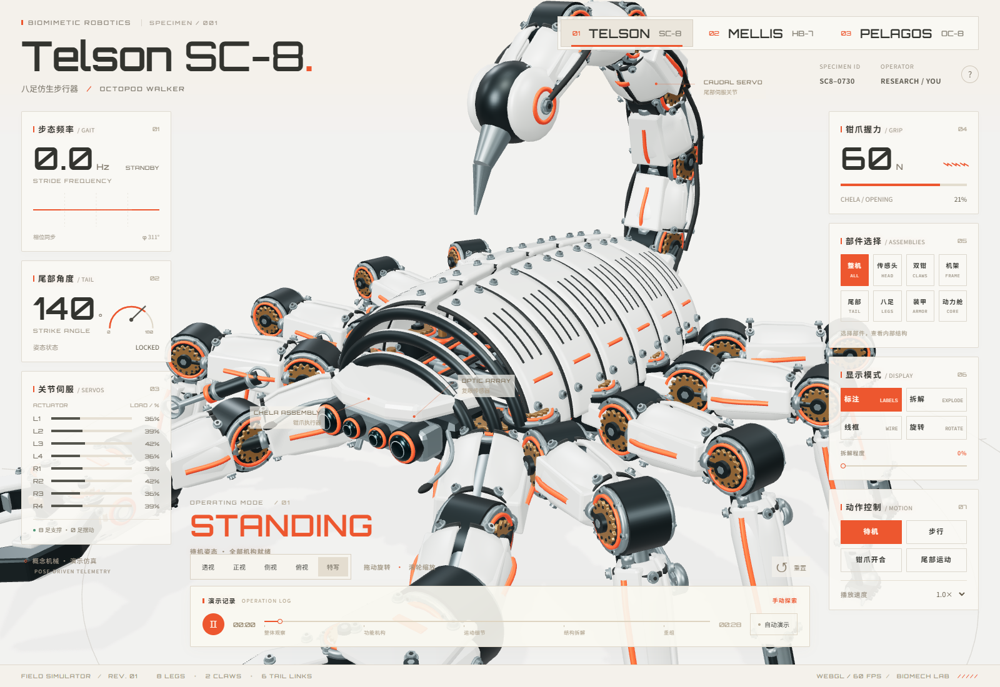
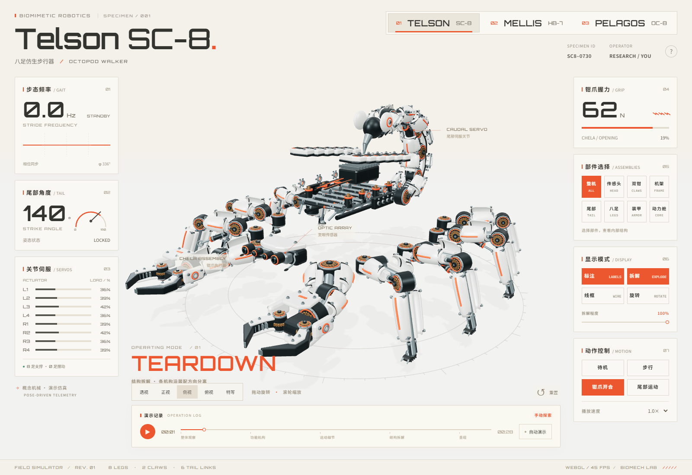
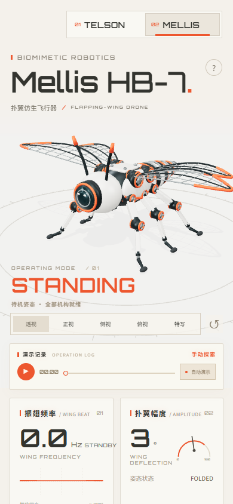
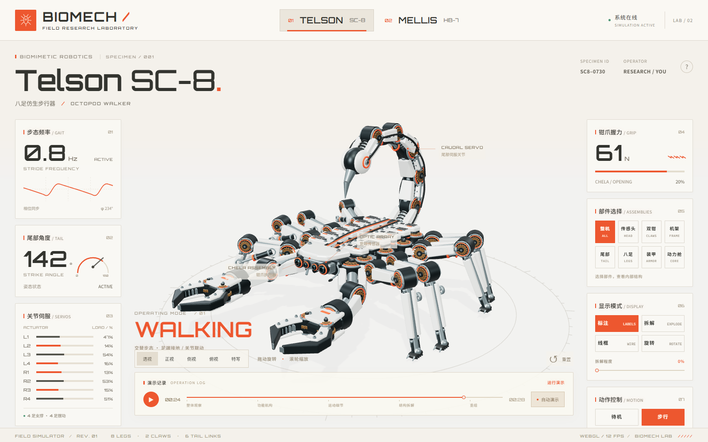

# BIOMECH / 仿生机械实验室

> 把一张机械生物动图，拆成可以观察、操作和重新组装的 3D 标本。

BIOMECH 是一个离线优先的交互式机械生物实验室：桌面端展示 Telson SC-8 仿生机械蝎子与 Mellis HB-7 仿生机械蜜蜂，用户可以旋转模型、隔离部件、展开装配层、切换动作和观察实时遥测。模型由 Blender 精细建模，网页端使用 Three.js 驱动同一套结构和运动数据。

## 预览

### SC-8 / 精密装配视图

<p align="center">
  
</p>

### 拆解与移动端

<table>
  <tr>
    <td width="58%"></td>
    <td width="42%"></td>
  </tr>
</table>

### 步态运动

<p align="center">
  
</p>

## 体验重点

- **两个可切换标本**：Telson SC-8 八足机械蝎子、Mellis HB-7 扑翼仿生蜜蜂。
- **精密部件层级**：装甲片、动力舱、齿轮、轴承、液压杆、线束、尾节和钳爪都可被隔离观察。
- **和模型同步的动作**：腿部 IK 步态、足端接地、尾部错相、钳爪错峰开合、蜜蜂翅膀与腹节运动都由同一套姿态数据驱动。
- **拆解式讲解**：部件选择、爆炸距离、线框、标签、四组相机视角、旋转台和 28 秒自动导览。
- **实时遥测面板**：步态频率、尾部角度、执行器负载、钳爪开度、动作状态和时间轴同步变化。
- **赛博中文界面**：Orbitron 拉丁字形配合 Noto Sans SC 中文字形，统一字重、字距和橙色信号色。
- **离线交付**：构建后的 `dist/index.html` 内嵌两个 GLB 模型、CSS 和 JavaScript，保留 `dist` 文件夹后可直接双击打开。

## 快速开始

需要 Node.js 20.19+ 或 22.12+。

```powershell
npm install --registry=https://registry.npmjs.org
npm run dev
```

打开 <http://127.0.0.1:5173/> 即可进入实验室。

## 构建与双击运行

```powershell
npm run build
```

构建脚本会先运行 Vite，再执行 `scripts/make-standalone.mjs`：

1. 将模型、样式和打包脚本内嵌到 `dist/index.html`。
2. 保留 `dist/assets/` 作为本地字体资源目录。
3. 让 `dist/index.html` 在 `file://` 环境下直接解析 GLB，不依赖本地 HTTP 服务。

构建完成后，直接双击：

```text
dist/index.html
```

建议将整个 `dist/` 文件夹一起移动，以保留 Orbitron、Noto Sans SC 等字体资源。模型已经内嵌，因此即使只保留 HTML，核心 3D 交互也能启动。

可以用下面的检查命令验证双击版本：

```powershell
npm run test:file
```

它会用 Chrome 通过真实 `file://` 地址打开 `dist/index.html`，确认模型就绪且没有页面错误或资源请求失败。

首屏 Loading 位于内嵌模型数据之前，下载大模型时即可显示。`npm run test:loading` 会暂停 HTML 下载，只发送前 64 KB，确认 Loading 可见后才继续下载，并验证两种标本均能加载。启动超过 30 秒时会显示等待说明及刷新入口。

## 操作方式

| 操作 | 作用 |
| --- | --- |
| 鼠标拖拽 / 触摸拖拽 | 旋转模型 |
| 滚轮 / 双指缩放 | 调整距离 |
| 点击模型部件 | 隔离对应装配 |
| `Space` | 播放 / 暂停演示 |
| `E` | 切换爆炸视图 |
| `L` | 显示 / 隐藏标注 |
| `R` | 重置相机和模型 |
| 视图按钮 | 切换透视、正面、侧面、俯视和特写 |
| 时间轴 | 跳转到自动导览的任意阶段 |

## Blender 工作流

当前 Blender 源文件位于 [`blender/biomech-specimens.blend`](blender/biomech-specimens.blend)。

- SC-8 REV 02 约 **5,144 个可编辑对象**，包含独立腿部关节、液压杆、齿轮、轴承、线束、装甲片和动力舱。
- 蜜蜂模型包含独立翅膀、腹部环节、腿部连接和内部传动结构。
- `blender/precision_scorpion.py` 负责高精度 SC-8 结构，`blender/export_models.py` 负责导出 GLB。
- `blender/export.ps1` 可在 Windows 上调用 Blender 并重新导出网页模型。

导出示例：

```powershell
pwsh -NoProfile -File blender/export.ps1
```

如果 Blender 不在默认路径：

```powershell
pwsh -NoProfile -File blender/export.ps1 -Blender "D:\Blender\blender.exe" -BlendFile "D:\Models\refined.blend"
```

导出后重新运行 `npm run build`，网页会读取最新 GLB 并重新生成可双击的单文件入口。

## 项目结构

```text
src/
├─ main.js              页面结构、交互、状态与遥测
├─ stage.js             Three.js 场景、GLB 加载、材质、标注和相机
├─ kinematics.js        标本定义、动作状态、导览时间轴
├─ scorpion-motion.js   SC-8 步态、尾节和钳爪运动学
├─ scorpion-rig.js      SC-8 腿部关节与液压连杆姿态
└─ style.css            实验室界面、赛博中文字体和响应式布局
blender/
├─ biomech-specimens.blend
├─ precision_scorpion.py
├─ export_models.py
└─ export.ps1
public/models/
├─ telson-sc8.glb
├─ mellis-hb7.glb
└─ manifest.json
scripts/
├─ make-standalone.mjs  将 dist 变成可双击运行的单文件入口
└─ test-file.mjs        通过 file:// 验证构建产物
```

## 验证

```powershell
npm run build
npm run test:math
npm test
npm run test:file
```

当前验证覆盖：

- SC-8 和 HB-7 模型加载与切换。
- 腿部关节独立运动、足端接地和杆长约束。
- 尾节错相、钳爪动作、蜜蜂翅膀和腹部动作。
- 爆炸、隔离、重组、标签、线框、时间轴和键盘快捷键。
- 390px 移动端无横向溢出。
- `file://` 双击入口无页面错误、无资源请求失败，模型状态正常就绪。

## 参考

交互拆解方式参考 [elvarofficial/teardown](https://github.com/elvarofficial/teardown)。本项目的机械结构、Blender 模型、运动学和界面代码均为本项目独立实现。
